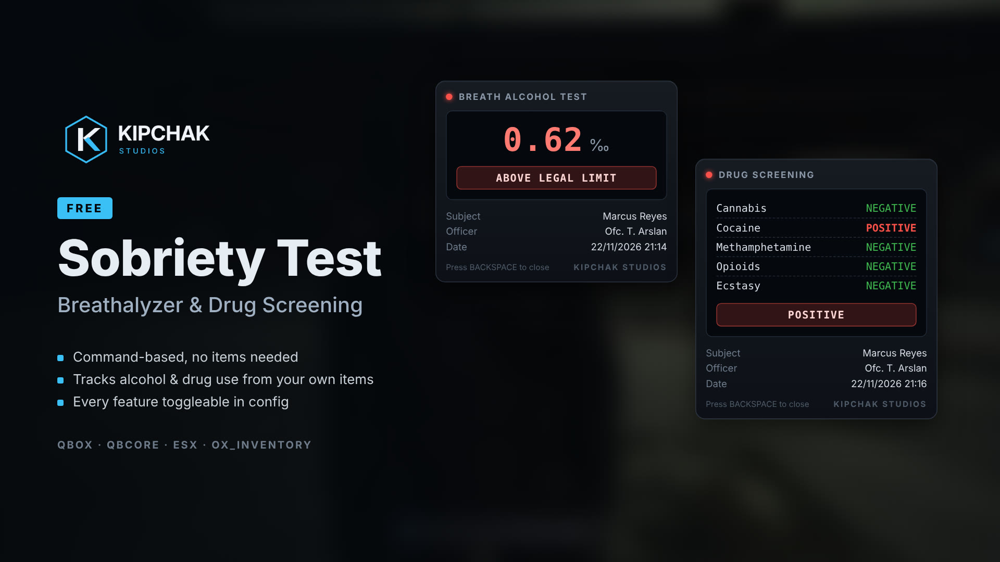
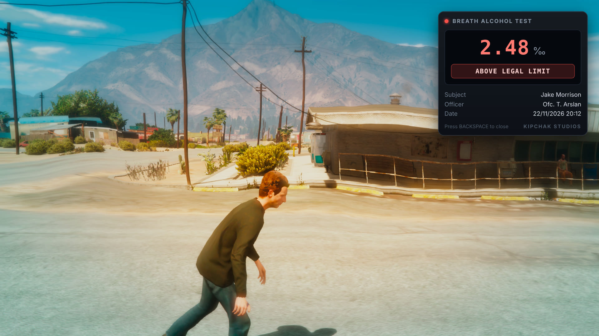
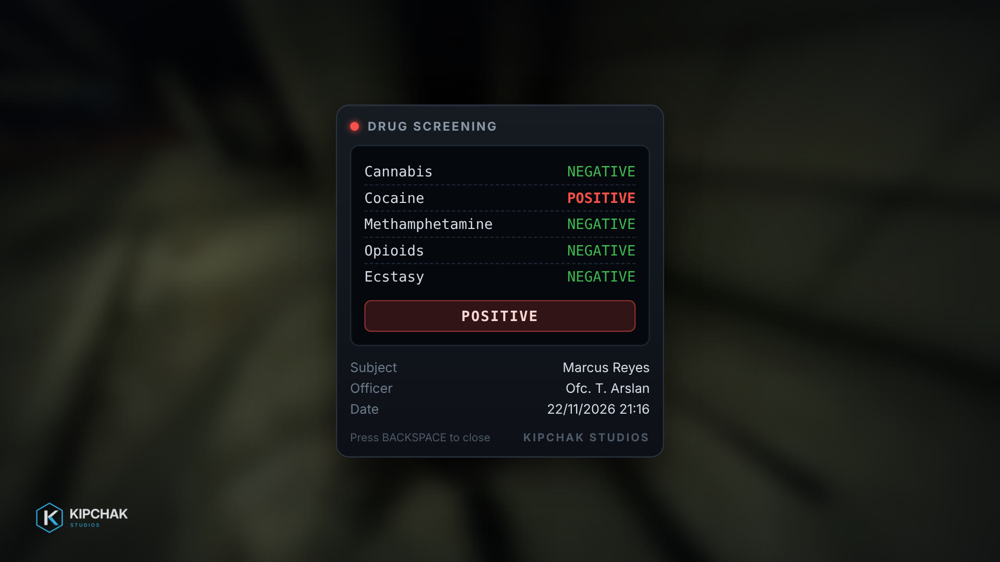
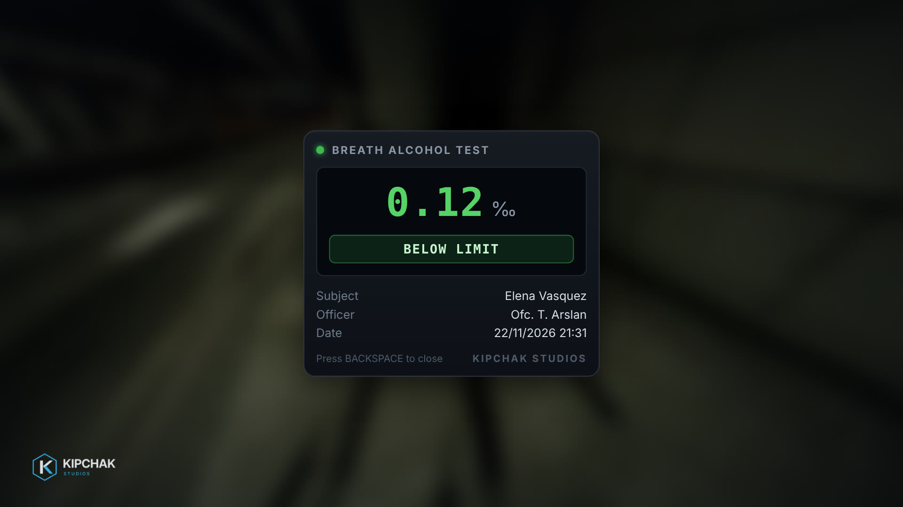

# Kipchak Sobriety



**[Download on Tebex](https://kipchak.tebex.store)** · **[Discord](https://discord.gg/jfaacuje8f)** · **[Calibrix – Forensic Ballistics Lab](https://kipchak.tebex.store)**

A free, lightweight breathalyzer and drug test script for police, by **Kipchak Studios**.

Officers type a command, the server checks permission, distance and cooldown, optionally asks the subject for consent, runs a short progress bar and shows the result on a small device-style card. Alcohol and drug levels are tracked on the server only; the client only displays.

## Screenshots



| Drug screening | Below limit |
| --- | --- |
|  |  |

## Features

- Breathalyzer (`/alcoholtest`) and drug test (`/drugtest`), no item required
- Server-side alcohol level (per mille) with decay over time and an upper limit
- Server-side drug detection per category (cannabis, cocaine, meth, opioids, ecstasy, add your own)
- Automatic item detection on ox_inventory, export integration for everything else
- Optional consent prompt with timeout
- Progress bar (emote optional), cancelled if the officer moves or the distance grows
- Result card (NUI) with auto close and a close key, permille or BAC % display, device variance
- Optional `/me` style 3D text, drunk effect, Discord logs, admin test commands
- Optional persistence across reconnects with KVP (no database)
- Qbox, QBCore and ESX with auto detection, English and Turkish locales
- Every feature can be switched off in `config.lua`
- Open source (MIT), no escrow

## Dependencies

- [ox_lib](https://github.com/overextended/ox_lib)
- One of: Qbox (`qbx_core`), QBCore (`qb-core`), ESX (`es_extended`)
- One of: ox_inventory, qb-inventory, ESX default inventory

## Installation

1. Put `kipchak_sobriety` in your resources folder.
2. Ensure it **after** ox_lib, your framework and your inventory:

```cfg
ensure ox_lib
ensure qbx_core
ensure ox_inventory
ensure kipchak_sobriety
```

3. Edit `config.lua` (jobs, item names, features).
4. Optional: put your Discord webhook in `server/sv_config.lua` and set `Config.Logs.Enabled = true`. This file is server only and never sent to clients.
5. Optional: to use the admin test commands, set `Config.AdminCommands.Enabled = true` and add the ACE:

```cfg
add_ace group.admin kipchak_sobriety.admin allow
```

## Item names

Every server names items differently, so the item lists live in `config.lua`.

```lua
Config.Alcohol.Items = { beer = 0.20, whiskey = 0.35, vodka = 0.40, wine = 0.25 }
Config.Drugs.Items = { joint = 'cannabis', cokebaggy = 'cocaine', crack_baggy = 'cocaine', meth = 'meth', oxy = 'opioids', xtcbaggy = 'ecstasy' }
```

- Alcohol: item name = amount added to the level (per mille).
- Drugs: item name = category from `Config.Drugs.Categories`.

Prefixes match every item whose name starts with the prefix:

```lua
Config.Alcohol.Prefixes = { cocktail_ = 0.30 }
Config.Drugs.Prefixes = { weed_ = 'cannabis' }
```

Careful with broad prefixes: `weed_` also matches items such as `weed_ak47_seed` or `weed_nutrition` if they are usable on your server. That is why the default prefix lists are empty.

On start the script checks that every configured item exists in your inventory and prints a warning like:

```
[kipchak_sobriety] Item 'bira' not found in inventory, check Config.Alcohol.Items
```

Disable this with `Config.StartupItemCheck = false`.

### Default item names

| Item | Source verified |
| --- | --- |
| beer, whiskey, vodka | Qbox `qbx_consumables` and QBCore `qb-smallresources` (usable alcohol) |
| wine | Exists in ox_inventory `data/items.lua` and qb-core `shared/items.lua`, but is **not** registered as usable by qbx_consumables or qb-smallresources |
| joint, cokebaggy, crack_baggy, meth, oxy, xtcbaggy | Qbox `qbx_consumables` and QBCore `qb-smallresources` |
| ESX names | **Not verified.** Current esx_core does not ship esx_basicneeds alcohol or drug items, and ESX items come from your database. Add your own names. |

## How item use is detected

### ox_inventory (automatic, works with Qbox, QBCore and ESX on ox_inventory)

- Items with `consume` in their ox_inventory definition: the `usingItem` hook is used only to listen (it never blocks). The level is raised in the hook's post event, which only reports success when the use was not cancelled and the item was actually removed.
- Items used through a framework usable callback (`CreateUseableItem` / `RegisterUsableItem`, for example `qbx_consumables`): the server event `ox_inventory:usedItem` is used. The script then checks whether the item count actually dropped, right away or within `Config.ItemDetection.ConfirmWindow` seconds (for scripts that remove the item after a progress bar). Cancelled uses do not remove the item, so nothing is added.
- Limitation: if a player uses a tracked item, cancels, and then loses the same item another way (gives or drops it) within the confirm window, it is counted as consumed.

### qb-inventory and ESX default inventory (one line)

Neither of these inventories fires a reliable server-side event that says an item was really consumed. Registering the item a second time would break the existing consumable script, so instead add one line to your consumable script, right where the item is removed:

```lua
exports.kipchak_sobriety:AddAlcohol(source, 0.20)
exports.kipchak_sobriety:AddDrug(source, 'cannabis')
```

Example for `qb-smallresources` (`server/consumables.lua`), inside the event that removes the alcohol item:

```lua
exports.kipchak_sobriety:AddAlcohol(source, 0.25)
```

## Commands

| Command | Who | Description |
| --- | --- | --- |
| `/alcoholtest [id]` | Allowed jobs | Breathalyzer test. Without an id, the nearest player is used if `Config.AutoNearest = true` |
| `/drugtest [id]` | Allowed jobs | Drug test |
| `/setalcohol [id] [value]` | ACE `kipchak_sobriety.admin` | Set alcohol level (testing) |
| `/adddrug [id] [category]` | ACE `kipchak_sobriety.admin` | Mark a drug category as used (testing) |
| `/resetsobriety [id]` | ACE `kipchak_sobriety.admin` | Reset all values (testing) |

Admin commands also work from the server console.

## Exports (server only)

```lua
exports.kipchak_sobriety:AddAlcohol(source, amount)
exports.kipchak_sobriety:AddDrug(source, category)
exports.kipchak_sobriety:GetAlcohol(source)
exports.kipchak_sobriety:GetDrugs(source)
exports.kipchak_sobriety:Reset(source)
```

There is no client event that can raise a level or create a result.

## Configuration

| Option | Description |
| --- | --- |
| `Config.Framework` | `'auto'`, `'qbox'`, `'qbcore'` or `'esx'` |
| `Config.Inventory` | `'auto'`, `'ox'`, `'qb'` or `'esx'` |
| `Config.Locale` | `'en'` or `'tr'` |
| `Config.Debug` | Detailed console logs |
| `Config.Commands` | Command names |
| `Config.AutoNearest` | Use the nearest player when no id is given |
| `Config.AllowSelfTest` | Let officers test themselves (default `false`). When no id is given and nobody is nearby, or their own id is given, the officer is the subject. Permission and cooldown still apply, the distance check is skipped |
| `Config.AllowedJobs` | Job = minimum grade |
| `Config.RequireOnDuty` | Officer must be on duty |
| `Config.MaxDistance` | Max distance between officer and subject (server checked) |
| `Config.Cooldown` | Seconds between tests per officer |
| `Config.ShowResultToTarget` | Show the card to the subject too, otherwise only a notification |
| `Config.Consent` | `Enabled`, `Timeout` (seconds) |
| `Config.Animation` | `Enabled` (main switch: progress bar with animation, `false` gives the result instantly), `Duration` (ms), `MaxMove` (meters before cancel), `Alcohol` / `Drug` (officer animation per test: `Dict`, `Clip`, `Flag`, optional `Prop` = `{ model, bone, pos, rot }`; set the entry to `false` to keep the progress bar without animation), `Target` (`Enabled`, default `false`, plus `Alcohol` / `Drug` animations for the tested person). No animation is played inside a vehicle, and cancelling removes the animation and prop |
| `Config.Result` | `Position` (`top-right`, `top-left`, `bottom-right`, `bottom-left`, `center-right`, `center-left`), `Duration` (ms, 0 = stay), `CloseKey`, `Branding` |
| `Config.AutoMe` | `Enabled`, `Duration` (ms), `Range` |
| `Config.DrunkEffect` | `Enabled`, `Levels` (min level, walk style, camera shake, screen effect strength) |
| `Config.Logs` | `Enabled`, `Username`. Webhook is in `server/sv_config.lua` |
| `Config.AdminCommands` | `Enabled` and command names |
| `Config.Persistence` | Keep values across reconnects (KVP, per character) |
| `Config.StartupItemCheck` | Warn about configured items missing from the inventory |
| `Config.ItemDetection` | `Enabled`, `ConfirmWindow` (seconds) for ox_inventory auto detection |
| `Config.Alcohol` | `Items`, `Prefixes`, `DecayPerMinute`, `Max`, `LegalLimit` (per mille), `Unit` (`'permille'` or `'bac'`), `Precision`, `RandomVariance` |
| `Config.Drugs` | `Categories` (name + detection minutes), `Items`, `Prefixes` |

Framework specific code (player data, job, notifications, death state) is in `bridge/framework/`, inventory specific code in `bridge/inventory/`. Adapt these files if you use a custom setup.

## Changelog

- 1.0.1 – The test animation now plays whenever `Config.Animation.Enabled` is `true` (the `Emote` switch is gone). Separate officer animations for the breathalyzer and the drug test, optional animation for the tested person (`Config.Animation.Target`). `Config.AllowSelfTest` ships as `false`.

## Support

- Discord: https://discord.gg/jfaacuje8f
- Store: https://kipchak.tebex.store

Looking for evidence work too? Check out **Calibrix – Forensic Ballistics Lab** on our store.
